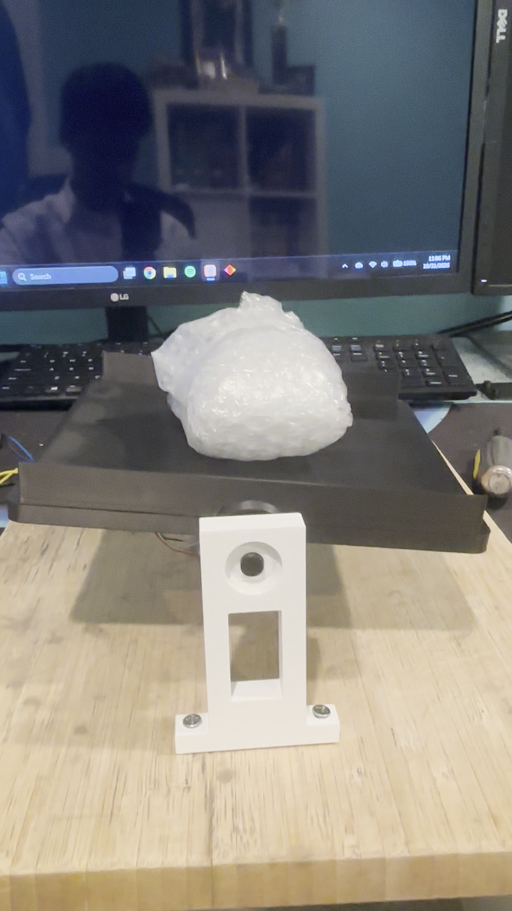
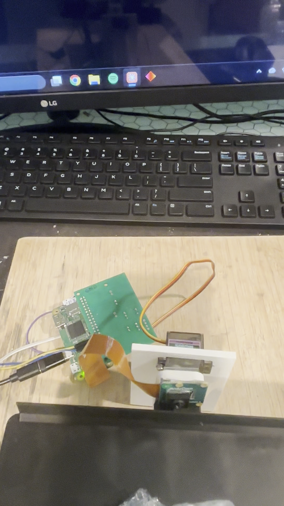
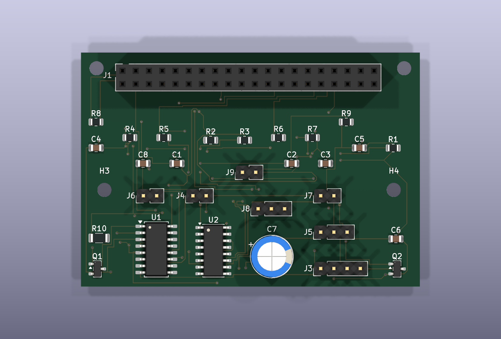
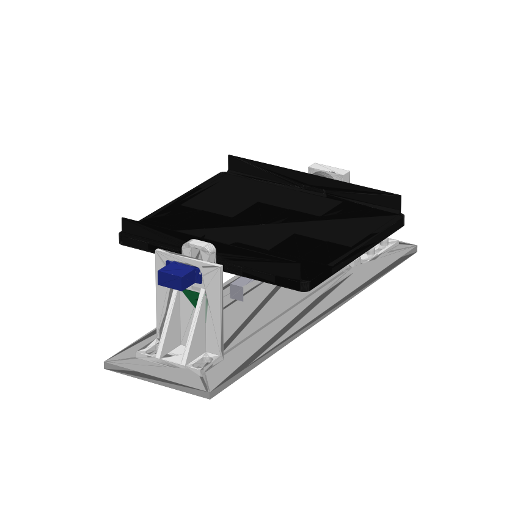

# smartbin

a sorting head that drops into a normal trash can and puts recyclables in the right side by itself.

[](https://kicanvas.org/?repo=https://github.com/DagaVedant/SmartBin/tree/main/PCB)

demo video: https://www.youtube.com/shorts/8E3T3RMJy3o

demo video: https://www.youtube.com/shorts/8E3T3RMJy3o





## what it does

you drop something on the pan. the load cell feels the weight change, the camera photographs the item, and a small neural net running on a pi zero w decides what it is. a servo tilts the pan and the item slides into the recycling side or the trash side. if the net is not sure, it goes to trash.

## why

- public recycling bins get contaminated really easily
- if enough non-recyclable stuff ends up in one, the facility can reject the whole load, so all of it goes to landfill anyway
- basically every recycling project i've seen is an app that tells *you* which bin to use
- i wanted the bin to just do it, so the person doesn't have to care

## how it works

```
item lands on the pan
   -> load cell reading rises above the threshold and settles
   -> camera captures a frame
   -> numpy cnn returns one of 7 classes plus a confidence
   -> the weight nudges the result (a 600 g "paper" is unlikely)
   -> jurisdiction file maps the class to recycle or trash
   -> below the confidence threshold it goes to trash
   -> "no_object" means a false trigger, so the pan stays level
   -> servo tilts, item slides, pan returns level, scale re-zeroes
   -> event written to sqlite, served as json by a small api
```

| class | bin |
|---|---|
| rigid_plastic, metal, glass, cardboard_paper | recycle |
| soft_plastic_foam, ewaste_hazard, no_object | trash |

the mapping lives in `firmware/config/jurisdiction.yaml`, so a different county's rules are a config change.

## hardware

| part | notes |
|---|---|
| raspberry pi zero w | armv6, 512 mb, no accelerator |
| camera module 3 | imx708, autofocus |
| mg90s servo | gpio12, hardware pwm |
| hx711 + 5 kg bar load cell | data gpio5, clock gpio6 |
| custom hat pcb | in `PCB/` |

the full parts list with prices is `BOM.csv`.

## the board

65 x 45 mm, 2 layers, pi zero hat footprint. fully routed, ground plane poured, drc clean.



| block | parts |
|---|---|
| load cell front end | hx711, pass transistor, feedback divider, 4 caps |
| battery sense | mcp3208 12-bit spi adc, divider, filter |
| servo rail | isolated supply, 470 uf bulk, star ground through one 0r link |
| led ring and break-beam | footprints are on the board but not used in the current build |

- the hx711 runs at 3.3 v, not 5 v, so the gpio can read it without level shifting
- the two grounds meet at exactly one point, so a stalling servo cannot brown out the pi
- the servo is on gpio12 because that pin is a hardware pwm channel

source files are in `PCB/`: `.kicad_pro`, `.kicad_sch`, `.kicad_pcb`, `schematic.pdf`, and `gerbers.zip`.

## the mechanics



all cad is in `CAD/`. `smartbin-head.step` is the full assembly; the parts below are the editable cadquery sources, each with `.py`, `.step` and `.stl`.

| part | job |
|---|---|
| `pan` | the tilting tray the item lands on |
| `pan-hub` | driven side, clamps onto the servo horn |
| `servo-mount` | flat plate the mg90s pushes through, shaft on the pivot axis |
| `bearing-block` | carries the 608zz on the idler side |
| `print-plate` | the mount, hub and block laid out for one print |

`base-plate`, `pan-idler` and `pi-mount` are step-only. `bearing-fit-test` and `bearing-608*` are for checking the bearing fit.

## the classifier

the pi zero w has no tflite or onnx wheels, so the classifier runs in plain numpy from a single `.npz` file (`firmware/smartbin/nn.py` and `firmware/smartbin/graphnet.py`). accuracy matters more than speed here, so the model on the bin is the mobilenetv3large itself at 224 px, with batch norm folded into the convolutions and the weights stored as fp16. the numpy version gives the same answers as keras, within 0.011 in probability.

```
python ml/cache.py --manifest <manifest.csv> --root <dataset root>   decode crops once at 224 px
python ml/export_teacher.py --teacher <teacher.weights.h5>           write firmware/models/smartbin-teacher.npz
python ml/distill.py --teacher <teacher.weights.h5>                  optional, train the small student instead
```

results on the held-out splits (accuracy, numpy, `ml/verify_export.py`):

| split | mobilenetv3large (on the bin) | small student |
|---|---|---|
| val | 91.8% | 71.3% |
| test, same sources | 91.8% | 69.4% |
| external test, new sources | 68.0% | 51.9% |

the teacher is 3.0m parameters and about 5.6 mb. it takes 40 to 100 ms per image in numpy on a laptop. i have not timed it on the zero w yet, and i expect it to be a few seconds per image there. the small student (420k parameters, 128 px, 1.5 mb) is still in `firmware/models/smartbin.npz` and can be selected in `firmware/config/device.yaml` if the teacher is too slow. these numbers come from 400 random images per split, so they are a little noisy.

## running it on the pi

install the python packages from apt, because a zero w has no wheels for them:

```
sudo apt install git python3-venv python3-numpy python3-pil python3-yaml python3-lgpio \
  python3-picamera2 python3-fastapi python3-uvicorn python3-pydantic python3-pydantic-core
git clone https://github.com/DagaVedant/SmartBin.git ~/SmartBin
python3 -m venv --system-site-packages ~/SmartBin/.venv
```

the servo uses the pi's hardware pwm, so add this to `/boot/firmware/config.txt` and reboot:

```
dtoverlay=pwm,pin=12,func=4
```

then calibrate, once each. the servo needs root because `/sys/class/pwm` is root-only.

```
cd ~/SmartBin/firmware
sudo ~/SmartBin/.venv/bin/python -m smartbin.calibrate servo
~/SmartBin/.venv/bin/python -m smartbin.calibrate scale --grams 47
```

the scale step asks you to empty the pan, then place a known mass (47 g here) on it, and stores the result in `firmware/config/scale_cal.json`.

run it:

```
sudo ~/SmartBin/.venv/bin/python -m smartbin
```

or install it as a service:

```
sudo cp ~/SmartBin/firmware/smartbin.service /etc/systemd/system/
sudo systemctl enable --now smartbin
```

set `hardware: fake` in `firmware/config/device.yaml` to run the whole pipeline on a laptop with fake hardware, and `python -m pytest firmware/tests` to run the tests.

## repo layout

```
CAD/        cadquery sources and step/stl files
PCB/        kicad project, schematic pdf, gerbers.zip
firmware/   the smartbin package, config, model, tests, systemd unit
ml/         distillation pipeline
BOM.csv     parts list
images/     photos and renders
```
